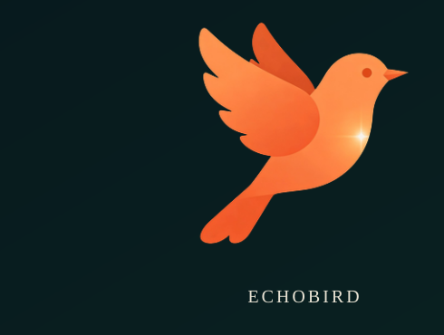
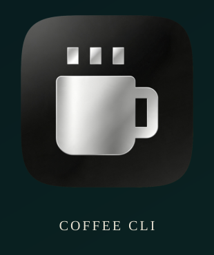
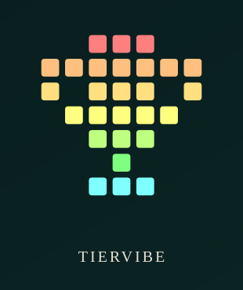
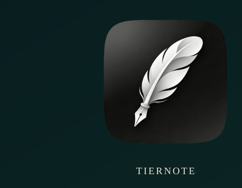
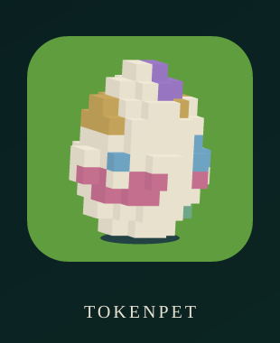
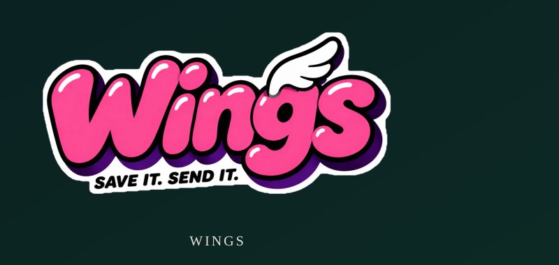

   
   
   
  

  Follow me on <a href="https://x.com/Edison7009">X @Edison7009</a> for new projects and development updates. 
  在 <a href="https://x.com/Edison7009">X 上关注我</a>，了解最新 AI 工具、项目进展与发布动态。

**EN**

**GAP** &nbsp;·&nbsp; Model vendors chase smarter AI; I create the AI tools humanity truly needs.

— 01 · **EchoBird** · Claude Code · Installing, model-switching, and local LLMs — all in one happy click.

— 02 · **Coffee CLI** · Claude Code · Desktop-grade AI in your terminal — paste images, resume history, commit with a Git tree.

— 03 · **TierVibe** · Claude Code · Tier lists + community — one click turns any tier list into rankings and short videos.

— 04 · **Open Longevity** · Codex · Longevity × AI — open, verifiable, for everyone.

— 05 · **TierNote** · Codex · Building the most affordable AI note tool — deeply optimized for DeepSeek and caching, turning videos into text, then text into PPTs and videos.

— 06 · **TokenPet** · A little egg is waiting for you to hatch it with tokens.

— 07 · **Wings** · Queue your next prompt while the AI is busy, then paste it back in one click — a sidebar for Claude, ChatGPT and other desktop AI apps.

---

**中文**

**GAP** &nbsp;·&nbsp; 模型厂商在追赶更聪明的 AI，而我在创造人类真正需要的 AI 工具。

— 01 · **EchoBird** · Claude Code · 把 Claude Code、ChatGPT 等的安装、本地大模型与模型切换，都化成一次幸福的点击。

— 02 · **Coffee CLI** · Claude Code · 让终端AI工具变成桌面级体验：粘贴图片 · 历史对话 · Git 树提交等。

— 03 · **TierVibe** · Claude Code · 从夯到拉 + 社区，一键生成 TierList 榜单和短视频。

— 04 · **Open Longevity** · Codex · 长寿科技 × AI，让科学延寿普惠化。

— 05 · **TierNote** · Codex · 打造最省钱的 AI 笔记工具，深度优化 DeepSeek 与缓存，视频转文字，文字再生成 PPT 和视频。

— 06 · **TokenPet** · 一个小小的蛋，正在等待你用 Token 来孵化它。

— 07 · **Wings** · AI 正忙时，先把下一句话存进 Wings，等它空了，点一下就贴回输入框 —— 吸附在 Claude、ChatGPT 等 AI 桌面应用旁的侧栏。

---

  <a href="https://openlongevity.life">openlongevity.life</a> &nbsp;·&nbsp;
  <a href="https://echobird.ai">echobird.ai</a> &nbsp;·&nbsp;
  <a href="https://coffeecli.com">coffeecli.com</a> &nbsp;·&nbsp;
  <a href="https://tiervibe.com">tiervibe.com</a> &nbsp;·&nbsp;
  <a href="https://tiernote.org/">tiernote.org</a> &nbsp;·&nbsp;
  <a href="https://tokenpet.ai/">tokenpet.ai</a> &nbsp;·&nbsp;
  <a href="https://aiwings.app">aiwings.app</a>

